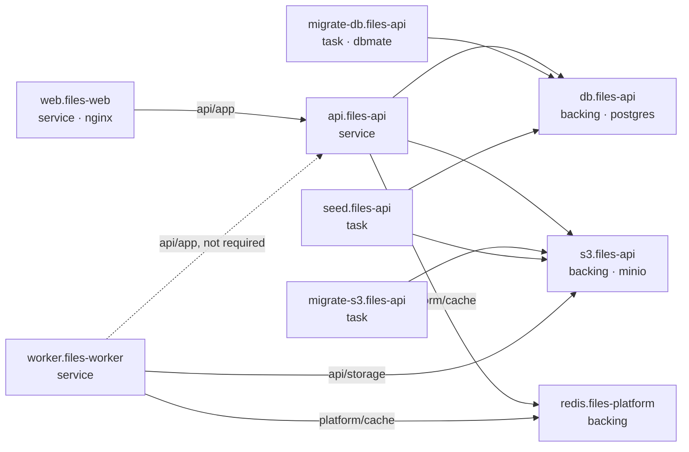

This is a book, not a reference. It starts with one repository answering
one health check and ends with four repositories, eight containers, two
migrations, a seed, a background worker, a debugger stopped on a line of
it, and the calls between them on record. Every piece is explained as it appears. Read it start to finish once;
after that the [.fghj.yaml reference](/reference/fghj-yaml/) is the page
you'll actually keep open.

## What you'll run

**files** is a small Dropbox: log in, upload a file, get a thumbnail, download
it again. It lives in the public
[fghj-examples](https://github.com/fghj-examples) org, split across four
repositories the way a real product is:

- **`files-api`** — the HTTP API (Node, Hono). It owns a Postgres database for
  the file records and an S3 bucket (MinIO) for the bytes, with a migration
  for each and a seed of sample files.
- **`files-web`** — the frontend: a React app behind nginx, which also
  forwards `/api/` to `files-api` so the browser only ever talks to one origin.
- **`files-worker`** — renders thumbnails. It takes jobs off a Redis queue,
  reads the original out of S3, and tells the api when it's done.
- **`files-platform`** — shared infrastructure, owned by nobody in particular:
  the Redis that the api and the worker both use.

By the end, the resolved graph looks like this:



And the app opens in your browser at `https://files.test`, with real HTTPS
and a certificate your system already trusts. Each service also gets a name
of its own, like `https://api.files-api.files.fghj.internal`. None of them
needs a port number.

## The one idea

Nobody owns the graph.

There is no `docker-compose.yml`, no root manifest, no repo that knows
about all the others. Each repo carries a `.fghj.yaml` that declares only
what *it* needs. `files-web` names `files-api` as a dependency; `files-api`
has never heard of `files-web` and never will. The graph above isn't
written down anywhere. fghj derives it by starting at one repo and walking
outward.

Every other design decision in fghj follows from that. When something
surprises you in a later chapter, it's usually this: the feature would have
required two repos to agree on something, and fghj refused. See
[Flat workspace model](/concepts/flat-workspace-model/) for the long
version.

## How to follow along

You don't type the app in. You clone it, and each chapter is a git tag:

```bash
git checkout ch2
git diff ch1 ch2
```

The first command puts a repo at the state that chapter describes. The
second shows you exactly what the chapter added, which is usually a few
lines of `.fghj.yaml` and the code they exist for. The chapters quote those
lines and explain them. The application code is ordinary TypeScript and
React, and the tutorial doesn't walk through it.

Not every repo appears in every chapter. `files-api` has a tag for each one,
`files-web` starts at `ch4`, and the worker and platform start at `ch5`. A
chapter that doesn't change a repo still has a tag for it, so `git checkout
chN` always works in every repo that exists by then. Chapter 8 changes no
repo at all, so it has no tags: stay on `ch7`.

## Before you start

You need:

- **A supported OS.** See [Installation](/getting-started/installation/#prerequisites).
- **Docker** running: Docker Desktop, OrbStack or Colima on macOS; Docker
  Engine, rootless Docker or Docker Desktop on Linux.
- **`fghj` and `fghjd` installed**, and `fghjd` running. See
  [Installation](/getting-started/installation/).
- **`cue`** on your `PATH`, for `fghj validate`.
- **git**, and network access to GitHub. The repos are public, so no keys
  are needed.

You don't need Node. Every build happens inside Docker.

Check the daemon is up:

```bash
fghj daemon status
```

## Chapters

1. [One service](/tutorial/01-one-service/): a repo, a `.fghj.yaml`, and a
   real HTTPS domain.
2. [Two stores](/tutorial/02-two-stores/): Postgres and S3 next to your
   service, the raw zone versus the http zone, healthchecks, and volumes that
   survive.
3. [Migrations and a seed](/tutorial/03-migrations-and-a-seed/): the third
   node kind, one that's *supposed* to exit.
4. [A second repo](/tutorial/04-a-second-repo/): the frontend, cross-repo
   dependencies, and a hostname of your own.
5. [Flows](/tutorial/05-flows/): repos you haven't cloned yet, shared
   infrastructure, and starting less than everything.
6. [When it goes wrong](/tutorial/06-when-it-goes-wrong/): the status
   vocabulary, drift, `fghj exec`, and the doctor.
7. [Attaching a debugger](/tutorial/07-attaching-a-debugger/): Node's
   inspector, `debug:`, and the one switch that isn't config.
8. [Capturing traffic](/tutorial/08-capturing-traffic/): an upload followed
   across four services, and what the Traffic tab can't see.
